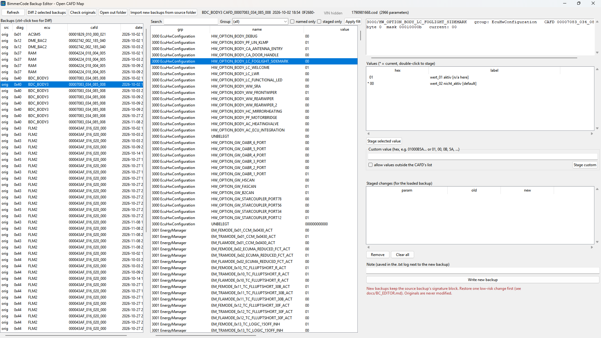

# Open CAFD Map

Readable coding names in E-Sys again, built from your own psdzdata and a shared, community-maintained list of names.

Current psdzdata ships CAFDs with every FDL name trimmed to `.`. E-Sys then shows a tree of dots. Open CAFD Map rebuilds what it can on your own machine:

- **Value labels from BMW's own coding rules.** Every value still carries the rule that selects it, and it's turned into readable text. For example `wert_02 [SA5AC]` means "value 2, coded when option 5AC is fitted". `[n/a here]` means the rule never applies to your reference vehicle class.
- **Names from the community.** `names\*.tsv` holds group, function and value names people have found: BimmerCode, screenshots, coding tables, backup diffs. Each name is keyed by CAFD id + datagroup + byte + mask, so it applies to every software version that has that function.
- **Contributed definition XMLs and cheat sheets.** `definitions\` holds definition files and cheat sheets people have shared, including the public community cheat sheets (GPL-3.0). `names\cheatsheet\` adds BMW names from a cheat sheet whose file can't be shipped. Their names are merged in the same way. A contributed definition is also used directly when your psdzdata doesn't have that CAFD version.
- **BMW's untrimmed names.** `definitions\untrimmed\` holds BMW's own group, function and value names (including the `aktiv` / `nicht_aktiv` labels of on/off options) from untrimmed CAFD dumps: about 149,000 functions, 274,000 values and 5,400 groups across 164 CAFD ids, covering G- and F-chassis ECUs. For G020 and F030, about 89% of functions across every CAFD version carry these verified names. They're keyed by each datagroup's exact function layout, so they apply to every software version with that layout and never land where bits moved. They're used twice: built into your definition DB (Backup Editor and E-Sys), and applied by the E-Sys agent at runtime, so even CAFD versions that were never exported get named when you open them.
- **Option titles.** FP criteria show the factory option's title (`SA5AC High-beam assistant`), from `data\sa_titles.tsv` or your own decrypted ISTA database.

- **BMW-style placeholders** for everything not named yet: `<Group>_<start>_<end>_<mask>`, e.g. `PfFesMaster_9_9_255`.

Everything above ships with the repo, so a fresh install sees every shared name. Only your private `my_names.tsv` and cheat sheets you add yourself stay local.

### Coverage
<picture>
  <source media="(prefers-color-scheme: dark)" srcset="docs/images/coverage-dark.svg">
  
</picture>

OpenLauncher works with any main series: set it in OpenLauncher. For G020 and F030, about 89% of functions across every CAFD version carry BMW's own verified names. OpenLauncher dynamically calculates the rest: functions are named from their group, byte and mask, and values are labelled with their coding rules. Untrimmed dumps of CAFDs your series doesn't share with those raise its bar the most ([CONTRIBUTING.md](CONTRIBUTING.md)).

### Before / after
The same FLM2 NCD (CAFD 00006DF0) in E-Sys's FDL-Editor, first in stock E-Sys, then in E-Sys started from OpenLauncher:

| Stock E-Sys | With Open CAFD Map |
|---|---|
|  |  |

It also includes a **BimmerCode Backup Editor**: edit parameters inside BimmerCode iOS backups and write them out as new backups to restore from the phone.

> Open CAFD Map is not affiliated with BMW. The project doesn't ship psdzdata, decrypted CAFDs or a coding database: those are built locally from your own E-Sys/psdzdata and stay in your `workspace\` folder. Contributed files in `definitions\` come from their contributors. Coding a car is at your own risk.

## Requirements
- Windows with **E-Sys** and its **psdzdata** (the psdzdata folder E-Sys is set up with)
- **Python 3.10+** with tkinter (the python.org installer includes it). No extra packages needed; setup can install Python for you.

## Install
1. On the [**Releases**](https://github.com/shamair28/OpenCAFDMap/releases/latest) page, download **`OpenLauncher-Setup.bat`** and double-click it. Windows may warn about a downloaded file: choose *More info* → *Run anyway* if you trust it.
2. Setup:
   - asks for an install folder (default `%LOCALAPPDATA%\OpenCAFDMap`; no admin rights needed)
   - checks for Python and offers to install it with `winget` if it's missing
   - downloads the latest release, verifies its SHA-256 checksum and installs it
   - creates **OpenLauncher** shortcuts on your Desktop and in the Start menu

**Upgrading:** run setup again. Your `workspace\` and settings are kept.
**Manual install:** extract `OpenCAFDMap.zip` from the release (or clone the repo) anywhere and double-click `OpenLauncher.bat`. OpenLauncher's **Desktop shortcut** button adds the icon shortcut.
**Uninstall:** delete the install folder and the OpenLauncher shortcuts.

## Quick start
1. Open **OpenLauncher** (the shortcut, or `OpenLauncher.bat`).
2. Check the **E-Sys folder** (found automatically if it's in the usual place) and the **main series** (`G020` covers G20/G21/G22/G23/G26/G28/G8x). Leave psdzdata empty to use the one E-Sys is set up with. Press **Save settings**.
3. Press **Start E-Sys with Open CAFD Map**, connect or open your coding data as usual, and open a CAFD: the tree shows names and labels. No build needed.
   - The first start reads your psdzdata's FA→FP mapping once (about 20 seconds) so option codes like `SA5AC` show up.
   - A CAFD opened for the first time shows BMW's untrimmed names straight away. Within a few seconds its full definition is built in the background (every shared name, value labels from the coding rules, your `my_names.tsv`) and the tree updates by itself. Later opens are instant.
4. Optional: press **Build definitions** to decrypt and index all of your psdzdata's CAFDs for that series (it can take a while). You need it for the **BimmerCode Backup Editor** and the command-line search tools; E-Sys doesn't.

Optional settings:

| Setting | Use |
|---|---|
| **BimmerCode backups** folder | Your car's exact CAFD versions are always exported, and the Backup Editor can import the backups. |
| **Reference vehicle** | Shortens labels to what matters for that vehicle class (series, market, LCI, engine). |
| **Cheat sheets** folder | Extra FDL cheat-sheet XMLs you have (the public community sheets are already included). Imported locally only, never shared. |
| **Export every CAFD version** | Exports all versions instead of the newest 3 plus the versions in your E-Sys SVT/CAF/NCD folders and your backups. |

After editing names, press **Apply names** (a few seconds), then reopen the CAFD in E-Sys.

## Updating definitions
New names and definition files are merged into the repo all the time; you don't need to reinstall to get them. OpenLauncher's **Definition updates** button:

- **Check for updates.** Also runs quietly when OpenLauncher opens. The label shows your installed definitions version and the latest available one.
- **Update now.**
  1. Downloads the latest `names\`, `definitions\` and `data\` from GitHub and verifies every file against the published checksums.
  2. Backs up any of your own edits to those folders (to `workspace\backups\`) and swaps the new files in.
  3. Re-applies names so E-Sys and the Backup Editor use them straight away.
- **Definitions up to date.** Nothing to do; clicking checks again.

Your workspace (DB, settings, `my_names.tsv`) is never touched.

**Launcher updates** (new OpenLauncher releases) are checked when OpenLauncher opens too. **Update launcher** downloads the latest release's `OpenLauncher-Setup.bat` and runs it for the folder OpenLauncher is installed in, even if that isn't the default folder. OpenLauncher closes, setup replaces the program files (keeping `workspace\` and `config.json`) and OpenLauncher starts again. Close E-Sys first. Any edits you made in `names\`, `definitions\` or `data\` are backed up to `workspace\backups\` first. If the release's definitions are older than the ones you had, OpenLauncher offers the newer definitions again right after.

**Git clones** follow `origin/main` instead of releases:
- **Update launcher** runs `git pull --ff-only`, then restarts OpenLauncher.
- **Force update** also works when a plain pull can't run (local edits or commits). It first saves everything, then moves `main` to `origin/main`:
  - uncommitted changes go to a git stash (`git stash list`);
  - local commits get a branch named `openlauncher-backup-<time>`.

  `workspace\` and `config.json` are git-ignored and never touched. A git clone is updated with `git pull --ff-only`. Command line: `python ocm\updater.py [--update]`.

The definitions version (`definitions.json`, e.g. `2026.11.09.1`) is bumped automatically on GitHub after every merged contribution.

## How the labels get into E-Sys (and why it can't conflict with other launchers)
Open CAFD Map **only runs inside an E-Sys it starts itself**: OpenLauncher's **Start E-Sys** button, or `Start-ESys-OpenCAFDMap.bat`.

- It starts a **new** E-Sys process from E-Sys's own JRE, classpath and VM options, read from your E-Sys version's own `E-Sys.bat` (only the classpath, working folder, `-X`/`-D` options and main class are taken; other additions such as `-javaagent` are left out). Java's built-in JavaScript runner is the entry point. [`esys/bootstrap.js`](esys/bootstrap.js) loads [`esys/agent.js`](esys/agent.js), then calls E-Sys's normal main class.
- **Nothing is installed into E-Sys**: no edited `.bat`, jar, config file, `-javaagent` hook or environment variable. The E-Sys folder is only read. E-Sys started any other way (`E-Sys.exe`, `E-Sys.bat`, another launcher) never sees our code.
- Both scripts **refuse to run** unless OpenLauncher's `-Docm.launcher=1` switch is present.
- The agent only **renames tree nodes in memory** (group, function and value names). It never changes coding data, NCDs or anything E-Sys sends to the car. The only files it writes in E-Sys's data folder are the FA / SVT backups (below). If it fails to load, E-Sys starts normally without labels.
- When you open a CAFD that has no definition file yet, the agent saves that CAFD as E-Sys loaded it to `workspace\runtime_cafd\` and runs [`ocm/runtime_defs.py`](ocm/runtime_defs.py) on it, the same labelling code as **Build definitions**. Everything stays on your machine. **Apply names** refreshes these definitions too.
- The agent also adds an **OpenLauncher** section to E-Sys's left navigation bar ([`esys/tools.js`](esys/tools.js), below). It's only in E-Sys started by OpenLauncher.

**E-Sys versions:** tested with E-Sys 25.10 (Java 11) and 3.35.3 (Java 8). E-Sys versions on Java 15 or newer can't be started this way (Java's JavaScript runner was removed) and OpenLauncher says so. Labels (including definitions built on demand) work on both: E-Sys 3.x keeps an open CAFD in its older CAF model, which the agent recognises separately, so 25.x is handled exactly as before. The OpenLauncher section (Compare NCD, Cheat Sheet) needs E-Sys 25.x's navigation bar.

**Other E-Sys versions** (for example 22-24 or 26) are tried rather than blocked. Labels, Compare NCD, the Cheat Sheet window and the FA/SVT backup run wherever E-Sys has what they need, and switch themselves off (with a line in `agent.log`) where it doesn't. Only Cheat Sheet **Apply**, which edits through E-Sys's FDL Editor, is held back on versions OpenLauncher wasn't tested with: tick **Try anyway** in OpenLauncher to allow it there.

**Logs** are in `workspace\logs\`: `esys.log` (E-Sys's own output for the latest start, previous one in `esys.prev.log`; attach it to bug reports), `agent.log` (labels and tools), `runtime_defs.log` and `decrypt.log`. If E-Sys fails while starting, it closes instead of leaving the splash screen up, and OpenLauncher shows the reason.

If you use a commercial launcher, keep using it as before. It runs its own E-Sys without Open CAFD Map; use OpenLauncher when you want the labels.

## Tools inside E-Sys
E-Sys started by OpenLauncher has an **OpenLauncher** section at the bottom of its left navigation bar.

**Compare NCD.** Two NCD files side by side, with the same names and value labels as the FDL editor.
- **NCD File 1** / **NCD File 2**: the file pickers open in E-Sys's CAF folder. **Compare** lines both files up function by function (group, byte, mask), so two versions of the same CAFD compare too.
- **NCD 1 is on the left and NCD 2 on the right.** Every function whose value differs is red on the right, and both sides scroll together. **Differences only** hides the identical rows.
- **Save diff** writes the differences as a tab-separated file (`NCD_diff_<cafd>_<v1>_vs_<v2>.tsv`). It opens in Excel or any editor: a `#` header with both files and CAFD versions, then one row per difference (`status`, `cafd_id`, `address`, `group`, `function`, `start`, `end`, `mask`, `hex1`, `value1`, `hex2`, `value2`).
- **Without a definition for that CAFD version**, the panel decrypts the CAFD with E-Sys's own PsdZ and builds the definition first (a few seconds, the same way as above).
- **Read-only:** Compare NCD never writes an NCD. To change coding, use the FDL editor as usual.

**Cheat Sheet.** E-Sys's own FDL Editor on the left, cheat sheets on the right.
- **The editor is E-Sys's real FDL Editor module:** load, edit, save and code exactly as usual. An NCD you opened with Coding's **Edit NCD** stays open when you switch to Cheat Sheet.
- **Sources:** the right pane lists every cheat sheet entry for the CAFD that's open: every FDL cheat sheet in `definitions\` (the community sheets and contributed ones) and the sheets in your **Cheat sheets** folder. Values can be value names (`aktiv`), hex (`07`) or byte lists for whole records (`04, 52, 44, ...`).
- **Each entry is checked against the open CAFD version:**
  - ✓ **compatible**: the function is at that group, byte and mask, and the value is one of its values. Values given by name, like `aktiv`, are matched through the labels.
  - ● **already set**: the open NCD already has that value.
  - ◐ **partly compatible**: only some steps fit this version.
  - ✎ **custom value**: a raw value that isn't one of the function's preset values, for example a modified light record. Its length is checked against the function.
  - ✗ **not for this version**: the function or value doesn't exist here.
- **Filters:** compatible entries only or all, one sheet or all of them, and a search box. Selecting an entry shows its steps: group, BMW function name, byte and mask, current value, target value and the sheet's comment.
- **Go to** selects the function in the FDL tree.
- **Apply** sets the entry's values in the FDL editor through E-Sys's own edit path. A preset value is picked from the value list; a custom value is entered in the raw value field (`Werte=`), and E-Sys's parsed result is checked byte for byte. Only the NCD open in the editor changes, and E-Sys marks it as modified. Saving and coding stay with you, as usual. Steps that don't fit are skipped and listed.

**FA / SVT auto-backup.** Every FA and SVT that E-Sys reads from the vehicle is saved as a copy in E-Sys's data folder (`Path.Home`, for example `H:\Data`), with no button to press:
- **FA:** `FA\FABak\<series>_<last 7 of VIN>.xml`; **SVT:** `SVT\SVTBak\<series>_<last 7 of VIN>.xml`. The files are E-Sys's own FA / SVT XML, so **Load** opens them like any other.
- **Covered:** Vehicle Order **Read** and SVT Actual **Read (VCM)** / **Read (ECU)** in Coding, and the FA and SVT editors. Files you **Load** aren't copied, and neither is the calculated SVT target.
- **Older backups are kept:** if the backup for that car already exists with different content, it's renamed to `<name>_<date-time>.xml` first. Reading an unchanged car again doesn't add a copy.
- **Log:** every backup is written to `agent.log`. Tested on E-Sys 25.x; on other versions it's tried too (see E-Sys versions above), so check the folders after your first read.

## BimmerCode Backup Editor
OpenLauncher → **BimmerCode Backup Editor**. Pick a backup, find a parameter by name, stage values, and **Write new backup**. Your original backups are never modified. Every new backup is a byte copy with only the edited coding bytes changed, verified after writing. Read [docs/BC_EDITOR.md](docs/BC_EDITOR.md) before restoring one.



## Contributing names
The names are the heart of the project, and every name helps everyone with that ECU. See [CONTRIBUTING.md](CONTRIBUTING.md). In short:

1. Add a row to `names\<ECU>.tsv`, or a definition XML / cheat sheet to `definitions\`.
2. Say where the names come from.
3. Run **Check contributions**.
4. Open a pull request.

## Command line
```
python ocm\pipeline.py build | names | check     same as OpenLauncher's buttons
python ocm\esys.py launch                         start E-Sys with Open CAFD Map
python ocm\runtime_defs.py --all                  rebuild the definitions E-Sys made on demand
python ocm\defdb.py search 5AC --cafd 000043AF    query the definition DB
python ocm\bc_tool.py show latest:BDC_BODY3 --group 3221
python ocm\cod_import.py --sheet                  BimmerCode backup diffs -> a sheet to name
python ocm\check_names.py --db                    which names match your DB
```

## Layout
```
OpenLauncher.bat           OpenLauncher (openlauncher.py)
Start-ESys-OpenCAFDMap.bat E-Sys with labels, using the saved settings
names\                     community names (CC0)          <- contributions go here
  cheatsheet\              BMW names from a cheat sheet that can't be shipped
definitions\               contributed definition XMLs and cheat sheets   <- and here
  community-cheatsheets\   public community cheat sheets (GPL-3.0, unchanged)
definitions.json           definitions version + checksums (bumped by GitHub; used by the updater)
data\                      FP criteria labels, SA option titles, ECU names, reference vehicles (contexts)
esys\                      bootstrap.js + agent.js + tools.js + cheatsheet.js + backup.js (in E-Sys), decrypt.js (headless), test_agent.js
ocm\                       Python tools: build_defdb, export_defs, rules, defdb, bc_tool, bc_gui, ...
docs\                      Backup Editor guide, examples
assets\                    OpenLauncher icon (make_icon.py redraws it)
installer\                 OpenLauncher-Setup.bat + release builder (used by the release workflow)
workspace\                 (created locally, git-ignored) DB, decrypted cache, definitions, runtime_cafd, logs, backups
```

## Licence
Code: MIT ([LICENSE](LICENSE)). Names in `names\`: CC0 ([names/LICENSE](names/LICENSE)), so anyone can reuse them. Files in `definitions\` keep the licence stated in them; otherwise CC0.
