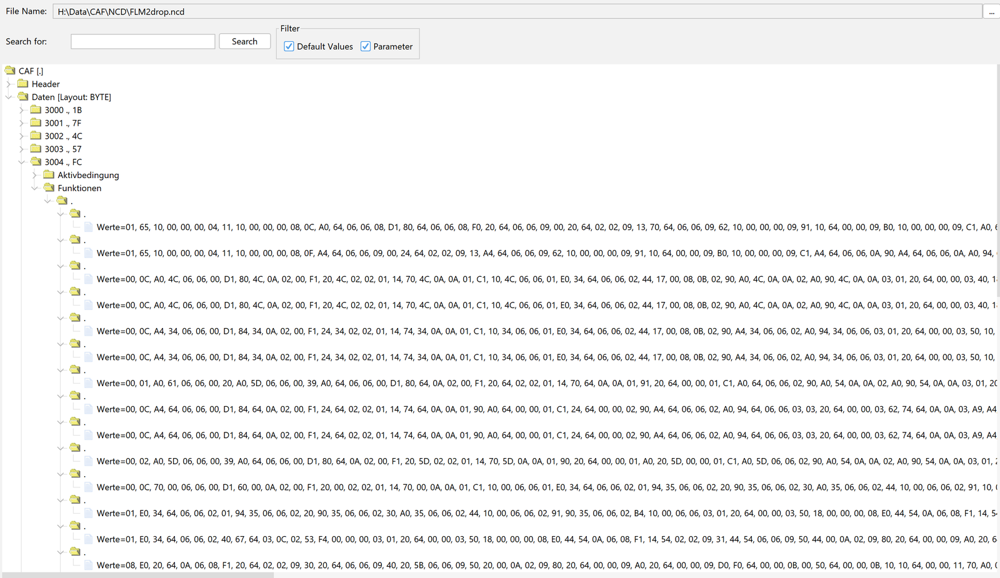
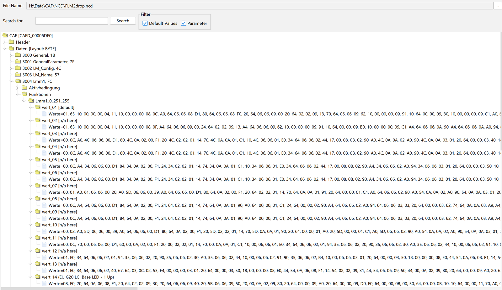

# Open CAFD Map

Readable coding names in E-Sys again, built from your own psdzdata and a shared, community-maintained list of names.

Current psdzdata ships CAFDs with every FDL name trimmed to `.`. E-Sys then shows a tree of dots. Open CAFD Map rebuilds what it can on your own machine:

- **Value labels from BMW's own coding rules.** Every value still carries the rule that selects it, and it's turned into readable text. For example `wert_02 [SA5AC]` means "value 2, coded when option 5AC is fitted". `[n/a here]` means the rule never applies to your reference vehicle class.
- **Names from the community.** `names\*.tsv` holds group, function and value names people have found: BimmerCode, screenshots, coding tables, backup diffs. Each name is keyed by CAFD id + datagroup + byte + mask, so it applies to every software version that has that function.
- **Contributed definition XMLs and cheat sheets.** `definitions\` holds definition files and cheat sheets people have shared, including the public community cheat sheets (GPL-3.0). `names\cheatsheet\` adds BMW names from a cheat sheet whose file can't be shipped. Their names are merged in the same way. A contributed definition is also used directly when your psdzdata doesn't have that CAFD version.
- **BMW's untrimmed names.** `definitions\untrimmed\` holds BMW's own group, function and value names (including the `aktiv` / `nicht_aktiv` labels of on/off options) from untrimmed CAFD dumps: about 93,000 functions and 184,000 values across 89 CAFD ids. They're keyed by each datagroup's exact function layout, so they apply to every software version with that layout and never land where bits moved. They're used twice: built into your definition DB (Backup Editor and E-Sys), and applied by the E-Sys agent at runtime, so even CAFD versions that were never exported get named when you open them.
- **Option titles.** FP criteria show the factory option's title (`SA5AC High-beam assistant`), from `data\sa_titles.tsv` or your own decrypted ISTA database.

Everything above ships with the repo, so a fresh install sees every shared name. Only your private `my_names.tsv` and cheat sheets you add yourself stay local.
- **BMW-style placeholders** for everything not named yet: `<Group>_<start>_<end>_<mask>`, e.g. `PfFesMaster_9_9_255`.

### Before / after
The same FLM2 NCD (CAFD 00006DF0) in E-Sys's FDL-Editor, first in stock E-Sys, then in E-Sys started from OpenLauncher:

| Stock E-Sys | With Open CAFD Map |
|---|---|
|  |  |

It also includes a **BimmerCode Backup Editor**: edit parameters inside BimmerCode iOS backups and write them out as new backups to restore from the phone.

> Open CAFD Map is not affiliated with BMW. The project doesn't ship psdzdata, decrypted CAFDs or a coding database: those are built locally from your own E-Sys/psdzdata and stay in your `workspace\` folder. Contributed files in `definitions\` come from their contributors. Coding a car is at your own risk.

## Requirements
- Windows with **E-Sys** and its **psdzdata** (the psdzdata folder E-Sys is set up with)
- **Python 3.10+** with tkinter (the python.org installer includes it). No extra packages needed; setup can install Python for you.

## Install
1. On the [**Releases**](https://github.com/shamair28/OpenCAFDMap/releases/latest) page, download **`OpenLauncher-Setup.bat`** and double-click it. Windows may warn about a downloaded file: choose *More info* → *Run anyway* if you trust it.
2. Setup:
   - asks for an install folder (default `%LOCALAPPDATA%\OpenCAFDMap`; no admin rights needed)
   - checks for Python and offers to install it with `winget` if it's missing
   - downloads the latest release, verifies its SHA-256 checksum and installs it
   - creates **OpenLauncher** shortcuts on your Desktop and in the Start menu

**Upgrading:** run setup again. Your `workspace\` and settings are kept.
**Manual install:** extract `OpenCAFDMap.zip` from the release (or clone the repo) anywhere and double-click `OpenLauncher.bat`. OpenLauncher's **Desktop shortcut** button adds the icon shortcut.
**Uninstall:** delete the install folder and the OpenLauncher shortcuts.

## Quick start
1. Open **OpenLauncher** (the shortcut, or `OpenLauncher.bat`).
2. Check the **E-Sys folder** (found automatically if it's in the usual place) and the **main series** (`G020` covers G20/G21/G22/G23/G26/G28/G8x). Leave psdzdata empty to use the one E-Sys is set up with. Press **Save settings**.
3. Press **Build definitions**. The first run decrypts your psdzdata's CAFDs for that series with E-Sys's own PsdZ (it can take a while), then builds the definition DB and the E-Sys definition files.
4. Press **Start E-Sys with Open CAFD Map**, connect or open your coding data as usual, and open a CAFD: the tree shows names and labels.

Optional settings:

| Setting | Use |
|---|---|
| **BimmerCode backups** folder | Your car's exact CAFD versions are always exported, and the Backup Editor can import the backups. |
| **Reference vehicle** | Shortens labels to what matters for that vehicle class (series, market, LCI, engine). |
| **Cheat sheets** folder | Extra FDL cheat-sheet XMLs you have (the public community sheets are already included). Imported locally only, never shared. |
| **Export every CAFD version** | Exports all versions instead of the newest 3 plus the versions in your E-Sys SVT/CAF/NCD folders and your backups. |

After editing names, press **Apply names** (a few seconds), then reopen the CAFD in E-Sys.

## Updating definitions
New names and definition files are merged into the repo all the time; you don't need to reinstall to get them. OpenLauncher's **Definition updates** button:

- **Check for updates.** Also runs quietly when OpenLauncher opens. The label shows your installed definitions version and the latest available one.
- **Update now.**
  1. Downloads the latest `names\`, `definitions\` and `data\` from GitHub and verifies every file against the published checksums.
  2. Backs up any of your own edits to those folders (to `workspace\backups\`) and swaps the new files in.
  3. Re-applies names so E-Sys and the Backup Editor use them straight away.
- **Definitions up to date.** Nothing to do; clicking checks again.

Your workspace (DB, settings, `my_names.tsv`) is never touched. Code updates come with a new release (or `git pull`). A git clone is updated with `git pull --ff-only`. Command line: `python ocm\updater.py [--update]`.

The definitions version (`definitions.json`, e.g. `2026.11.09.1`) is bumped automatically on GitHub after every merged contribution.

## How the labels get into E-Sys (and why it can't conflict with other launchers)
Open CAFD Map **only runs inside an E-Sys it starts itself**: OpenLauncher's **Start E-Sys** button, or `Start-ESys-OpenCAFDMap.bat`.

- It starts a **new** E-Sys process from E-Sys's own JRE, classpath and VM options, the same as `E-Sys.bat`. Java's built-in JavaScript runner is the entry point. [`esys/bootstrap.js`](esys/bootstrap.js) loads [`esys/agent.js`](esys/agent.js), then calls E-Sys's normal main class.
- **Nothing is installed into E-Sys**: no edited `.bat`, jar, config file, `-javaagent` hook or environment variable. The E-Sys folder is only read. E-Sys started any other way (`E-Sys.exe`, `E-Sys.bat`, another launcher) never sees our code.
- Both scripts **refuse to run** unless OpenLauncher's `-Docm.launcher=1` switch is present.
- The agent only **renames tree nodes in memory** (group, function and value names). It never changes coding data, NCDs or anything E-Sys sends to the car. If it fails to load, E-Sys starts normally without labels.

If you use a commercial launcher, keep using it as before. It runs its own E-Sys without Open CAFD Map; use OpenLauncher when you want the labels.

## BimmerCode Backup Editor
OpenLauncher → **BimmerCode Backup Editor**. Pick a backup, find a parameter by name, stage values, and **Write new backup**. Your original backups are never modified. Every new backup is a byte copy with only the edited coding bytes changed, verified after writing. Read [docs/BC_EDITOR.md](docs/BC_EDITOR.md) before restoring one.

## Contributing names
The names are the heart of the project, and every name helps everyone with that ECU. See [CONTRIBUTING.md](CONTRIBUTING.md). In short:

1. Add a row to `names\<ECU>.tsv`, or a definition XML / cheat sheet to `definitions\`.
2. Say where the names come from.
3. Run **Check contributions**.
4. Open a pull request.

## Command line
```
python ocm\pipeline.py build | names | check     same as OpenLauncher's buttons
python ocm\esys.py launch                         start E-Sys with Open CAFD Map
python ocm\defdb.py search 5AC --cafd 000043AF    query the definition DB
python ocm\bc_tool.py show latest:BDC_BODY3 --group 3221
python ocm\cod_import.py --sheet                  BimmerCode backup diffs -> a sheet to name
python ocm\check_names.py --db                    which names match your DB
```

## Layout
```
OpenLauncher.bat           OpenLauncher (openlauncher.py)
Start-ESys-OpenCAFDMap.bat E-Sys with labels, using the saved settings
names\                     community names (CC0)          <- contributions go here
  cheatsheet\              BMW names from a cheat sheet that can't be shipped
definitions\               contributed definition XMLs and cheat sheets   <- and here
  community-cheatsheets\   public community cheat sheets (GPL-3.0, unchanged)
definitions.json           definitions version + checksums (bumped by GitHub; used by the updater)
data\                      FP criteria labels, SA option titles, ECU names, reference vehicles (contexts)
esys\                      bootstrap.js + agent.js (in E-Sys), decrypt.js (headless), test_agent.js
ocm\                       Python tools: build_defdb, export_defs, rules, defdb, bc_tool, bc_gui, ...
docs\                      Backup Editor guide, examples
assets\                    OpenLauncher icon (make_icon.py redraws it)
installer\                 OpenLauncher-Setup.bat + release builder (used by the release workflow)
workspace\                 (created locally, git-ignored) DB, decrypted cache, definitions, logs, backups
```

## Licence
Code: MIT ([LICENSE](LICENSE)). Names in `names\`: CC0 ([names/LICENSE](names/LICENSE)), so anyone can reuse them. Files in `definitions\` keep the licence stated in them; otherwise CC0.
